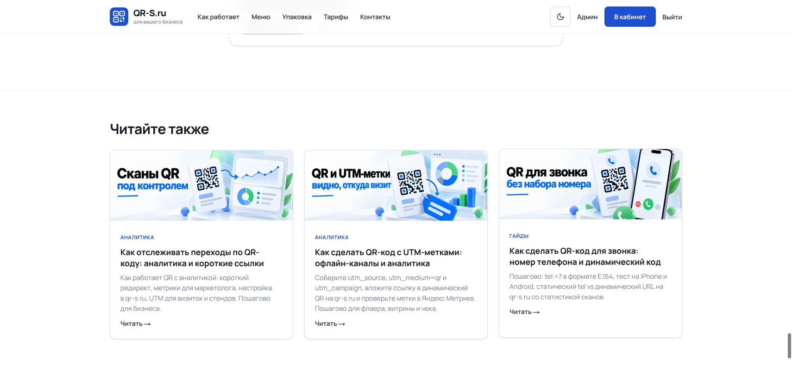
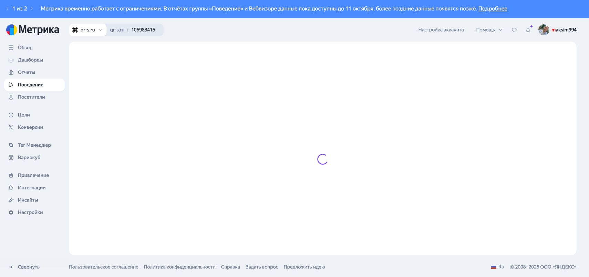

# ТЗ-10, этап 1 — релиз 21 октября 2026

Код `a6fa101794a01198fec2d1204640c5c373ad48bb` выпущен в существующий Coolify resource. Деплой завершён успешно 21.10.2026 в 10:42:54 МСК. Предыдущий код — `0eca424199f0fec94d041fa54ab700bc35c5f14b`. Этапы 2 и 3 этим релизом не выпускаются.

## Резервная копия и миграция

- Штатные `qr-s-backup.service` и `qr-s-backup-verify.service` завершились успешно. Проверка восстановления: `2026-10-21T07:26:14.657797Z`, 457 файлов, 37 QR, 7 пользователей.
- Дополнительный `pg_dump -Fc`, снимок QR v2, отпечатки клиентских таблиц, исходники статей и предыдущий образ сохранены **на сервере**, в `/var/lib/qr-s-release/20261021-tz10`. Каталог 0700, дамп 0600. Секреты и клиентские снимки в этот каталог репозитория не переносились.
- Дамп восстановлен в отдельный PostgreSQL 16 на изолированной внутренней Docker-сети, без production volume. На копии штатным `scripts/migrate-deploy.mjs` применена добавочная миграция `20261021093000_blog_related`. Все 18 миграций приняты.
- Новый образ проверен на восстановленной базе. Сохранность 37 QR и исходных клиентских таблиц подтверждена; старый образ также работает на мигрированной копии. Для медиа использовалось изолированное зеркало 338 публичных изображений.
- На production `init-db` завершился с кодом 0, исходный mount PostgreSQL сохранён. `APP_URL` остался **точно** `https://qr-s.ru/`.
- После релиза app healthy; app, PostgreSQL, Redis, notification-worker, metrika-worker и analytics-purge работают, число перезапусков у каждого — 0.
- Временные тестовые контейнеры и их сеть удалены после проверки. Дамп и образ `qr-s-rollback:tz10-20261021` оставлены для отката.

## Согласованные статьи

Первый запуск был **без `--apply`**, на read-only снимке шести реальных исходников. Максим подтвердил [план](ARTICLE-PLAN.md), заменив суффикс календаря на `| qr-s.ru`. После этого все шесть исходников повторно сравнены с рассмотренным снимком; версии и `updatedAt` совпали. Затем `--apply` успешно отрепетирован на восстановленной копии, повторён dry-run на актуальной production-базе и выполнен production `--apply`.

Записывал существующий административный HTTP API `/api/admin/blog/{id}`, через прикладную сессию администратора и CSRF. Постоянный API-ключ не создавался, auth/CSRF middleware не менялся. Служебный [адаптер](admin-article-transport.mjs) читает статьи через Prisma, проверяет согласованные исходники и точный allowlist правок, перед записью повторяет проверку версии и передаёт `expectedUpdatedAt`. Записи напрямую в таблицы статей не выполнялись. Сам `tz10-article-maintenance.mjs` запускался с `--apply`; snapshot-режим по-прежнему запрещает `--apply`.

| Статья | Версия до → после | Результат |
|---|---|---|
| `primenenie-qr-kodov-v-cafe` | 3 → 4 | Ровно две ссылки: `/dashboard/create/menu` → `/qr-menu`, `/dashboard/create/url` → `/#create-qr` |
| `qr-kod-dlya-kalendarya` | 3 → 4 | Итоговый `<title>`: `QR-код для календаря: ссылка на событие \| qr-s.ru` |
| `dinamicheskij-i-staticheskij-qr-kod-raznica` | 7 → 8 | Два тега, ручные рекомендации: аналитика, затем UTM |
| `qr-kod-s-analitikoj-i-korotkoj-ssylkoj` | 7 → 8 | Добавлены теги `динамический qr`, `смена ссылки` |
| `qr-kod-s-utm-metkami` | 3 → 4 | Добавлены те же два тега |

Целевая статья `qr-kod-menu-restoran-kafe` осталась в версии 4, без изменений. В поле metaTitle календаря хранится основная часть без бренда: шаблон страницы добавляет ` | qr-s.ru` ровно один раз. Результат подтверждён HTTP и настоящим браузером.

Все пять записей — `minorEdit`; отдельная проверка подтвердила сохранение slug, `publishedAt`, `firstPublishedAt`, `contentUpdatedAt` и остальных полей вне плана. Все **45** статей после применения совпали с результатом репетиции, кроме технического `updatedAt` и счётчиков просмотров/лайков. История увеличилась ровно на пять ревизий: 249 → 254. Склейка не выполнялась. Таблицы клиентских данных, оплат, подписок, редиректов, API-ключей и отложенных ревизий сохранили прежние отпечатки.

## Старые QR и публичный сайт

- Снимок v2 всех **37** ранее существовавших QR совпал после миграции, после релиза и после правок статей: содержимое, настройки доступа, shortCode, тип, владелец, архивность и APP_URL сохранены.
- **29** старых HTTP-контрактов совпали до/после: 25 ответов 307 и четыре ответа 200; назначение редиректа, видимый текст hosted-страницы либо байты vCard сохранены. QR с расходуемым лимитом сканирований не открывались; их данные покрыты сравнением снимка. Физическое сканирование каждого бумажного экземпляра не выполнялось.
- [11 публичных проверок](public-smoke.json): health, главная и её ссылки без `?static=`, контакты с Telegram, robots, lifetime, три коротких title, ссылки статьи о кафе, login, sitemap. HTTP 200, HSTS без `includeSubDomains`, отсутствует X-Powered-By. На приватном login iframe ограничен своим сайтом; публичные страницы разрешают согласованные домены Метрики.
- До релиза прошли 260 unit-тестов, lint, сборка, проверка типов, 75 HTTP-проверок на синтетической базе, desktop/mobile проверки Chrome и WebKit и 14 синтетических проверок iframe. Подробности — в [отчёте этапа](../tz10-stage1/REPORT.md).
- Дополнительно выполнена сверка восьми старых платежей YooKassa: все подтвердились отменёнными, начислений 0, отпечатки данных не изменились. В runner-образе штатному CLI не хватает `nanoid`; сверка выполнена из builder-образа того же коммита с полными зависимостями, в существующей сети и с временным закрытым env-файлом. Env-файл удалён. Работающие web/worker-процессы этой ошибки не показывают.

Монитор `/api/health` сделал 325 проб с 10:40:08 до 10:56:08 МСК: 322 ответа 200, один тайм-аут и два 503 во время переключения контейнеров. Последний успешный ответ перед переключением — 10:42:41; следующий — 10:43:01. Точное время недоступности из этих дискретных проб не определяется. После 10:43:01 остальные пробы успешны. Исходные отметки UTC — в [health.jsonl](health.jsonl).

## Вебвизор — проверка не пройдена

Настоящий счётчик **106988416** открыт в авторизованном Chrome до и после релиза. Яндекс показывает предупреждение: данные поведения и Вебвизора доступны до 11 октября, более поздние появятся позже. Сам раздел остаётся на индикаторе загрузки; список старых записей также получить не удалось после повторной загрузки. Это состояние наблюдалось ещё до выкладки.

**Воспроизведение реальной записи не подтверждено.** Корректная CSP и прошедшие синтетические iframe-проверки не заменяют эту приёмку. Требуется повторить открытие записи, когда интерфейс Метрики станет доступен. Изменений настроек счётчика не выполнялось.

## Артефакты

- [Согласованный план](ARTICLE-PLAN.md), [результат публичных проверок](public-smoke.json), [монитор](health.jsonl).
- [Успешный деплой](deploy-success.png), [контакты на production](contacts-live.png), [связанные статьи](related-live.png).
- Приватные дампы, снимки и точные логи применения оставлены только в защищённом серверном каталоге; в Git их нет.
- Отчёт и уточнение maintenance-скрипта закоммичены локально. В Coolify подтверждён режим `Deploy on push (webhooks)`, поэтому новый push после успешной приёмки не выполнялся: он может повторно перезапустить production. Выпущенный SHA остаётся `a6fa101`.

Этап 1 выпущен; технические проверки и утверждённые правки статей завершены. Открытый пункт приёмки — реальное воспроизведение Вебвизора. Склейку кафе после переноса уникального содержимого выполняет Максим в админке. Следующий этап начинается после проверки текущего.
