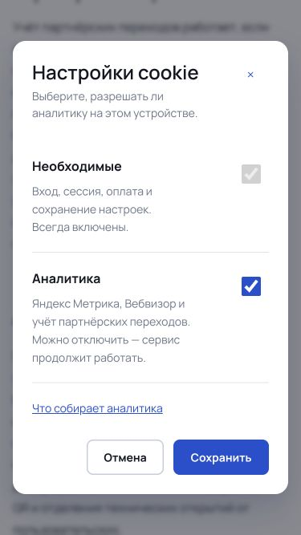

# ТЗ-11: локальная сдача

21 октября 2026. Ветка `codex/tz11-metrika-opt-out`, основа `d6072c2`. **Push и выкладка не выполнялись.** Production остаётся на прежней версии `b3a929d`; production-база и настройки счётчика не изменялись.

Локальная версия работает на http://127.0.0.1:3010. Настройки можно открыть кнопкой в подвале либо на http://127.0.0.1:3010/privacy-policy#cookie-settings.

## Выполнено

- Метрика и `webvisor:true` запускаются после клиентской загрузки страницы, если аналитика не отключена. Ожидания нажатия «Разрешить» больше нет. Без JavaScript счётчик не запускается.
- Уведомление содержит «Настроить» и «Понятно». «Понятно» закрывает уведомление и отдельно запоминает это действие, не создавая запись о согласии и не меняя настройку аналитики.
- В настройках две категории: «Необходимые» всегда включены; «Аналитика» управляет Метрикой, Вебвизором и партнёрским учётом. Изменение применяется кнопкой «Сохранить», отмена и Escape сохраняют прежний выбор. Подвал открывает окно непосредственно.
- Отключение сохраняется в прежнем ключе `qrs_cookie_choice`; явный отказ из `cookie_consent` также распознаётся. Старые, просроченные и относящиеся к другой редакции отказы сохраняются до изменения пользователем или удаления настроек браузера. Cookie `qrs_analytics_disabled=1` передаёт серверу только признак отключения, без идентификатора посетителя.
- При отказе счётчик получает `destruct`, ожидающая инициализация очищается, собственный загрузчик удаляется. Доступные сайту cookie `_ym_*` и ключи `_ym*` в localStorage/sessionStorage очищаются; сессии входа и CSRF не затрагиваются. После ограниченного по времени запроса отзыва страница перезагружается. На других доменах Яндекса сайт удалять cookie не может.
- Нечитаемые настройки не включают аналитику автоматически. Ошибки чтения/записи cookie и localStorage не ломают страницу; отказ сохраняется в доступном хранилище или памяти текущей вкладки.
- Цели, получение ClientID и атрибуция оплаты используют общую проверку доступности аналитики. Поздний ClientID после отключения отбрасывается. Сервер проверяет признак отказа перед новой атрибуцией оплаты и партнёрского перехода/регистрации. Запрос отзыва удаляет партнёрскую cookie и отзывает ожидающую атрибуцию оплаты; уже учтённые расчёты не отменяются.
- В новых запросах используется маркер `opt-out:2026-10-21.1`. Он обозначает режим сбора, а не состоявшееся нажатие согласия. Существующие названия колонок `consentVersion` / `metrikaConsentVersion` сохранены для совместимости схемы; новые значения содержат режим. Таблицы доказательств принятия документов не используются для вымышленных нажатий cookie.
- Просмотры учитываются при переходах между страницами App Router: `defer:true` плюс явный `hit`, без повторного `init`. В URL сохраняются рекламные метки и код партнёра; прочие query-параметры, фрагменты и учётные данные удаляются из передаваемого адреса.
- Автоматический учёт внешних ссылок выключен (`trackLinks:false`), чтобы переход по распознанному QR не передавал его содержимое в отчёт внешних ссылок. Карта кликов и Вебвизор включены. Кнопка «Открыть» сканера дополнительно помечена `ym-disable-tracklink`.
- Рабочие области генераторов, результаты/видео сканера, кабинет, админка и формы авторизации скрыты средствами разметки Вебвизора. Общий Input отключает запись вводимых значений. В продуктовые события передаются только прежние разрешённые параметры; содержимое QR туда не добавляется.
- Основной счётчик сайта исключён с клиентских страниц `/r`, `/p`, `/v`, `/g`, `/preview`, `/mini`; их собственная система пикселей и согласий остаётся отдельной. Алгоритмы перенаправления и статистики клиентских QR не менялись.

## Документы

Подготовлена локальная редакция `2026-10-21.1` с новым разделом 4. Уведомление, названия кнопок, партнёрский учёт, способы отключения и сроки приведены в соответствие с реализацией. Из оферты также убрана ставшая неверной фраза о запуске только после отдельного выбора. Принятие оферты по-прежнему не называется согласием на аналитику.

Предыдущая редакция сохранена в `src/lib/legal-history/2026-10-18.ts`; ранее сохранённые квитанции и данные не переписывались. Обновление номера документов не стирает отказ от аналитики.

Сроки уточнены по официальной справке: [записи Вебвизора — 15 дней, включая текущий](https://yandex.ru/support/metrica/ru/webvisor/requirements); [сроки cookie различаются](https://yandex.ru/support/metrica/ru/general/cookie-usage), в том числе существуют технические cookie до двух лет. Убрана общая формулировка, будто все cookie действуют до года или конца сессии. Записи сессий не объявляются анонимными только из-за маскирования полей.

Тексты страницы с логотипом, ссылка на статью и формулировки «без регистрации» уже были в предыдущем релизе, повторно не заменялись устаревшим вариантом.

## Проверки

| Проверка | Результат |
| --- | --- |
| Unit/integration suite | **278 / 278**, включая режим по умолчанию, старые отказы, блокировки хранилищ, поздний ClientID и защиту параметров |
| ESLint | Успешно, без ошибок и предупреждений |
| Production build | Успешно; прежнее предупреждение Next о migration middleware → proxy остаётся |
| HTTP | 13 публичных страниц отвечают 200; три проверки API аналитики/партнёров прошли |
| Новый посетитель | Один `init` с `webvisor:true` до нажатия кнопок, один первый `hit` |
| Старые отказы | Старый ключ, другая редакция и просроченный отказ — без загрузчика и счётчика |
| Отключение и reload | Загрузчика и маркера счётчика нет; можно снова включить |
| SPA | Переход сканер → тарифы добавляет `hit` и цель тарифов без второго `init` |
| Другая вкладка | Изменение отказа отключает счётчик уже открытой вкладки |
| Партнёры | Включённая аналитика создаёт переход; отказ блокирует учёт даже со старой партнёрской cookie |
| Интерфейс | 1440×900 и 375×667, светлая/тёмная тема, нет горизонтального переполнения, Escape возвращает фокус |
| Ссылка на политику | Закрывает окно; у страницы нет оставшихся inert/блокировки прокрутки |

Браузерная проверка счётчика проведена через локальный proxy на `127.0.0.1:3013`, который подменяет только загрузчик Яндекса локальной фикстурой и задаёт тестовый номер `999999999`. **Она не отправляла визиты в реальную Метрику и не доказывает получение записи реальным Вебвизором.** В локальной `qr_design` номер счётчика изначально не задан и не изменялся. Прямой сервер на 3010 поэтому позволяет проверять интерфейс и API без внешней аналитики.

Схема БД не менялась, миграций нет. Для проверки партнёрского API в отдельной `qr_design` использовался временный синтетический партнёр; его тестовые переходы удалены после проверки. Пользователи, QR и платежи этим тестом не создавались.

Независимый finish reviewer нашёл два P2: навигация за открытым окном и необработанный запрет cookie. Оба исправлены и повторно проверены. Итог: [**resolved / clear**](VERDICT.md). [Первичная проверка](REVIEW.md).

## Граница локальной приёмки

Для текущих `frame-ancestors` проверены локальные HTTP-заголовки и существующие тесты доменов Метрики; настройки безопасности не расширялись. [Официальная схема CSP](https://yandex.ru/support/metrica/ru/code/install-counter-csp), [маскирование содержимого](https://yandex.ru/support/metrica/ru/webvisor/settings).

После отдельной команды на выкладку потребуется проверить реальный `tag.js`, запись и воспроизведение Вебвизора на production, а также отсутствие запросов после сохранённого отказа. Реальная запись, процент записываемых визитов и работа блокировщиков локальной фикстурой не подтверждаются. Черновик документов пока доступен только локально.

## Артефакты

- [Браузерные результаты](browser-results.json), [команды тестового счётчика](counter-events.json), [локальный журнал маршрутов](network.json), [HTTP/API](http-checks.json).
- [Тесты](tests.log), [ESLint](lint.log), [сборка](build.log).
- [Desktop](desktop-settings-reviewed.png), [mobile light](mobile-settings-reviewed.png), [mobile dark](mobile-settings-final.png).

